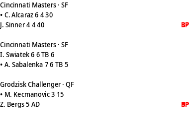

# inkycal-tennis

A third-party [Inkycal](https://github.com/aceinnolab/Inkycal) module that puts
live tennis scores on your e-paper display.



*(Preview rendered from mocked data with `tests/render_preview.py` — no
hardware or API key needed to reproduce it.)*

## What it does

- Shows matches **currently in progress** across ATP, WTA, Challenger, ITF and
  juniors: tournament + round, per-set games, current in-game points, a `•`
  marker on the player who is serving, and a **BP** marker (on the colour layer,
  so it renders red on 3-colour displays) when the receiver holds a break point.
- The break point is **derived, not guessed**: receiver on `AD`, or receiver on
  `40` while the server is below 40 — and never inside a tiebreak.
- When nothing is live, it falls back to the **upcoming fixtures** schedule
  (cached for 6 hours to save API quota).

Data comes from the [Live Tennis API](https://livetennisapi.com)
([OpenAPI spec](https://docs.livetennisapi.com/openapi.yaml)). It uses only the
free endpoints: `GET /matches?status=live` and `GET /fixtures`.

## What it requires

- Inkycal 2.x installed (this module targets the current `InkycalModule` /
  `Canvas` API on `aceinnolab/Inkycal` main).
- A Live Tennis API key. The **free tier** needs no card:
  <https://livetennisapi.com/subscribe/free>. Python dependency: `requests`
  (already an Inkycal dependency).

## API quota — set your refresh interval honestly

The free tier allows **30 requests/minute and 100 requests/day**. This module
makes **one API call per refresh** while matches are live; when nothing is
live it makes one extra fixtures call at most once per 6 hours (cached
in-process).

- **Recommended: `update_interval` of 15 minutes or more.** 15-minute
  refreshes are ~96/day, plus at most ~4 fixture calls — right at the free
  tier's 100/day ceiling.
- If the same key is used by anything else, use 20–30 minutes or a paid tier.
- Don't set the interval below 15 minutes on a free key: you will hit the
  daily cap and the display will stop updating for the rest of the day.
- Historical results (`status=completed`, `/history/*`) are part of the
  **paid** tiers (BASIC and up). This module does not use them.

## Installation

These steps follow Inkycal's
[developer guide](https://github.com/aceinnolab/Inkycal/blob/main/docs/docs/dev_doc.md)
for registering a custom module.

1. Copy the module file into Inkycal's modules directory:

   ```bash
   cd Inkycal/inkycal/modules
   wget https://raw.githubusercontent.com/livetennisapi/inkycal-tennis/main/inkycal_tennis.py
   ```

2. Register it in `Inkycal/inkycal/modules/__init__.py` by adding one line to
   the `InkycalModuleImporter` enum:

   ```python
   class InkycalModuleImporter(Enum):
       ...
       Tennis = "inkycal.modules.inkycal_tennis.Tennis"
   ```

3. Add the module to your `settings.json`:

   ```json
   {
       "position": 2,
       "name": "Tennis",
       "config": {
           "size": [400, 300],
           "api_key": "YOUR_LIVE_TENNIS_API_KEY",
           "tour": "all",
           "padding_x": 10, "padding_y": 10, "fontsize": 14, "language": "en"
       }
   }
   ```

### Config options

| key | required | values | meaning |
|-----|----------|--------|---------|
| `api_key` | yes | string | your Live Tennis API key |
| `tour` | no | `all` (default), `atp`, `wta`, `challenger`, `itf`, `juniors` | show one tour only; each value includes its doubles draws |

## Running the tests

The tests mock the API — no network and no key needed:

```bash
git clone https://github.com/aceinnolab/Inkycal
pip install -e ./Inkycal pytest
git clone https://github.com/livetennisapi/inkycal-tennis
cd inkycal-tennis && pytest tests/ -v
```

`python tests/render_preview.py` regenerates the screenshot above.

## Development status

Maintained. I run the API behind it, so field-shape changes upstream will be
reflected here. Issues and PRs welcome.

## License

MIT (this module). Inkycal itself is GPL-3.0; if you distribute this module
combined with Inkycal, the combination is governed by the GPL.
